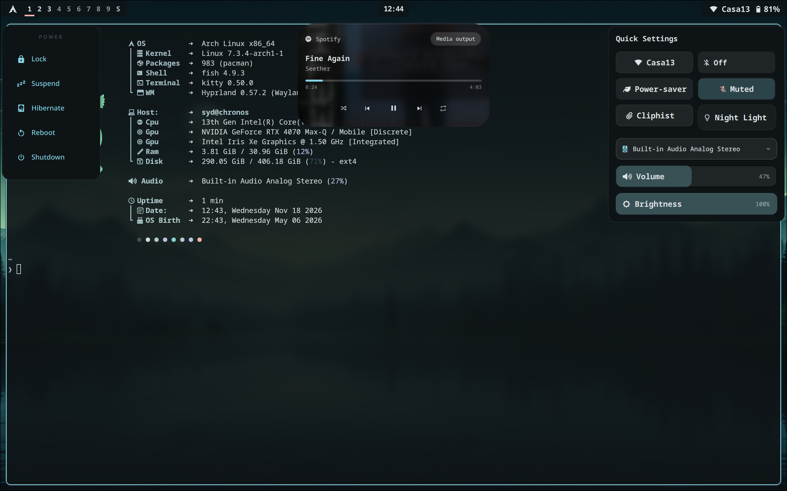
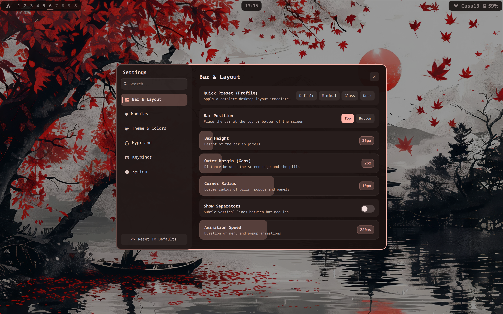
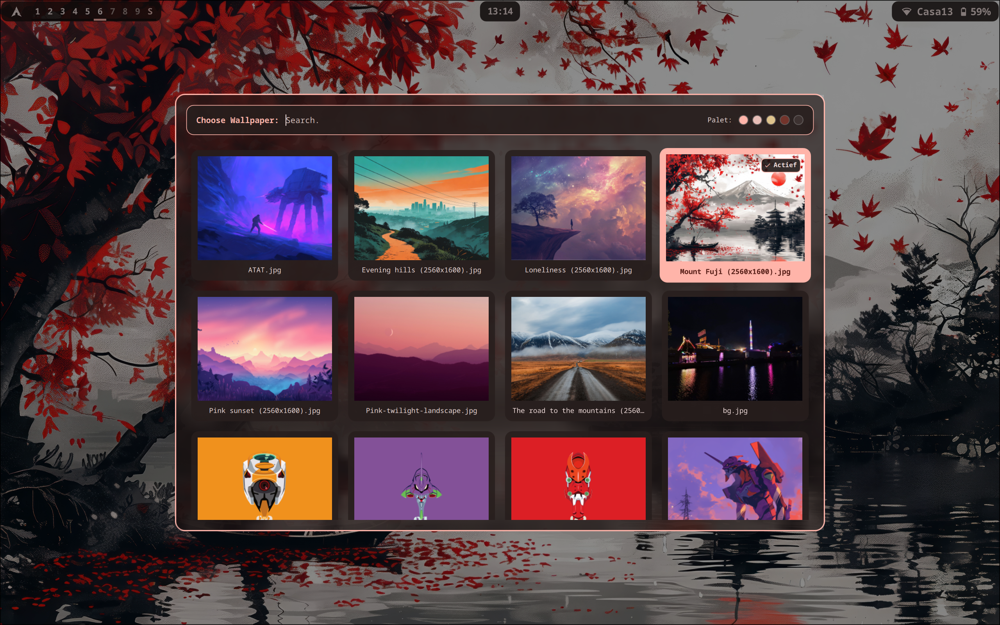

# Quickshell config for Hyprland


## Main Overview



## Settings menu



## Theme switcher


## Keybinds in Hyprland for Quickshell
```lua
hl.bind(mainMod .. " + K", hl.dsp.exec_cmd("qs ipc call quicksettings toggleBluetooth"))
hl.bind(mainMod .. " + P",       hl.dsp.exec_cmd("qs ipc call mediaplayer toggle"))
hl.bind("CTRL + SHIFT + ESCAPE", hl.dsp.exec_cmd("qs ipc call powermenu toggle"))
hl.bind(mainMod .. " + C", hl.dsp.exec_cmd("qs ipc call quicksettings toggle"))
hl.bind(mainMod .. " + T", hl.dsp.exec_cmd("qs ipc call themeswitcher toggle"))
hl.bind(mainMod .. " + S", hl.dsp.exec_cmd("qs ipc call settings toggle"))
```
